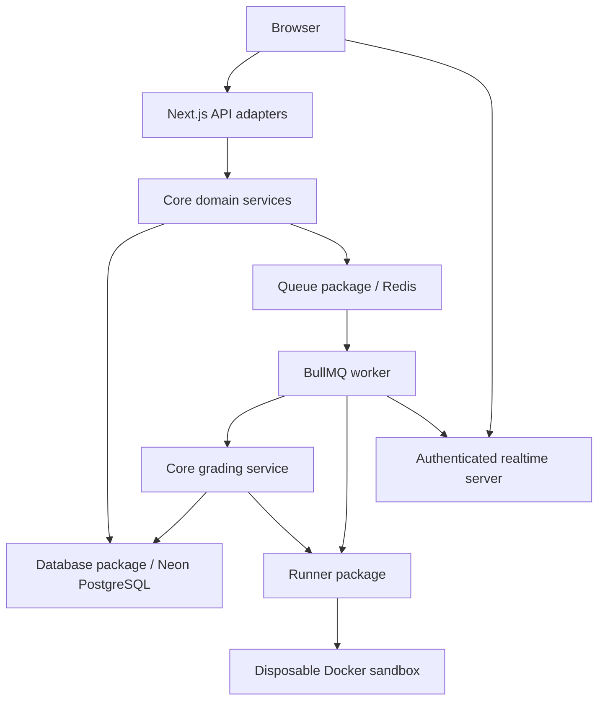

# CodeRank architecture

CodeRank uses a **layered modular monolith with an asynchronous execution worker**,
stored in an npm-workspaces/Turborepo monorepo. The Next.js application owns the UI
and HTTP API; feature modules share one PostgreSQL schema. A separately deployed
BullMQ worker consumes Redis jobs and invokes disposable Docker sandboxes. This is
a web/worker architecture with shared domain packages, rather than independently
owned microservices. `apps/` contains entry points; `packages/` contains reusable
domain and infrastructure code. Domain modules are organized by feature.

## Runtime and package boundaries

| Location | Responsibility |
|---|---|
| `apps/web/src/app/api` | HTTP adapters, request authentication and response contracts |
| `apps/web/src/lib/execution-api.js` | Shared execution authorization, validation, admission and cookies |
| `apps/web/server.js`, `src/lib/realtime.js` | Socket authentication, room authorization, trusted worker relay |
| `apps/worker/src/workers` | Queue consumption and completion notifications |
| `packages/core/src/modules/users` | User domain service |
| `packages/core/src/modules/courses` | Course and department domain service |
| `packages/core/src/modules/practicals` | Practical-access policy and transactional management |
| `packages/core/src/modules/mapping` | Course/faculty mapping management |
| `packages/core/src/modules/reports` | Authorized course/practical reports and administrative counts/logs |
| `packages/core/src/modules/practicals/StudentPracticalService.js` | Student practical discovery and cohort filtering |
| `packages/core/src/modules/submissions` | Submission/workspace service, grading and persistence repository |
| `packages/core/src/services` | Compatibility exports preserving existing imports |
| `packages/database` | Neon client, migration loader and version ledger |
| `packages/queue` | BullMQ producer and atomic Redis admission |
| `packages/runner` | Language runtimes, Docker transport and sandbox lifecycle |
| `database/migrations` | Baseline schema, indexes and transactional grading functions |
| `infrastructure` | Authoritative image and Compose definitions |

Core has no dependency on the runner package. Grading receives an executor factory
from the worker. The runner has no database, queue, JWT or web dependency.
Practical CRUD, deadline changes, mapping and submission-history routes are thin
adapters. User-management mutations and course marks reporting also use domain services;
Student practical discovery, practical reports and administrative counts/logs also
delegate SQL to domain services. The health route is the explicit infrastructure
exception: it passes the database client to the read-only schema readiness probe.
Architecture tests reject direct SQL and runner imports in other route adapters,
reverse dependencies from packages into apps, and core dependencies on the runner.

## Execution and grading

Execution requests validate language/source size and practical membership before
admission. Jobs carry a server-generated UUID, owner and enqueue timestamp. Job
reads require ownership; anonymous playground runs use an opaque HttpOnly cookie.

Capacity checks and insertion share one Redis Lua invocation. The adapter extends
BullMQ's standard insertion script and pins BullMQ to 6.3.10. Updating that package
requires the concurrent-producer integration test. Global capacity counts waiting,
paused, active, delayed and prioritized jobs. Per-owner membership is cleaned
against terminal job state on the next admission. Admission fairness is a pending
job cap, not round-robin scheduling. The producer only creates ordinary jobs.

Each execution gets a new Docker container with no network, a read-only root,
non-root UID, dropped capabilities, CPU/memory/PID limits and private tmpfs mounts.
The capability-free supervisor runs as root; submitted programs execute explicitly
as UID 1000 so they cannot stop its watchdog. Containers expire independently of the worker and are removed after execution.
Timeout/output overflow destroys the container, including detached processes.
Docker is a host-kernel isolation boundary; use dedicated runner hosts and validate
isolation before exposing untrusted workloads. The Docker socket belongs only to
the trusted worker, never to the web process or job container.

Practical grading compares outputs outside the sandbox. The grading service
redacts hidden cases, uses enqueue time for lateness, and calls a single PostgreSQL
function to save attempt, best grade and case results. An advisory transaction lock
serializes changes per student/practical. A unique constraint prevents duplicate
best grades. Job IDs provide replay protection. Reset timestamps reject older
queued submissions after deletion. Infrastructure/database failures fail the job.

## Compatibility and scaling limits

All inventoried API paths and page locations remain. Execution uses asynchronous
202 responses plus protected job polling. User lists return arrays with a bounded
`limit` (default 100, maximum 200), optional `cursor`, and `X-Next-Cursor` response
header. Student/faculty management pages consume those cursors. The faculty mapping
selector collects pages; it still retains all faculty options in browser memory.

Realtime supports an opt-in shared Redis adapter. Set `REALTIME_REDIS_ENABLED=true`
before `CLUSTER_ENABLED=true`, and set a bounded `WEB_CONCURRENCY`. All supported
socket clients use WebSocket-only transport, so connections do not require polling
affinity. Cross-server authorized delivery has a real Redis integration test; the
full production Next.js cluster still requires deployment validation. Worker replicas can use separate Docker hosts, but their
aggregate concurrency must be measured against actual host resources. No throughput
or production-readiness claim follows from unit tests.

Practical/mapping mutations and their audit entries commit together through
migration 003. Graded cases are immutable; metadata edits may retain identical
cases, and deletion archives the practical to preserve grading history. Concurrent
remapping and grading are coordinated through row locks.

Faculty submission pages use opaque keyset cursors for every supported sort.
Timestamp cursors retain PostgreSQL precision. The faculty table navigates pages;
small practical selectors collect bounded pages. C and JavaScript function harnesses
support all ten static problems and compare returned values outside the sandbox.

User mutations and faculty reassignment share a transactional management lock.
Course matrices page both axes and use a single authorized SQL snapshot.
Migration 004 bridges the deployed missing `updated_at` column.

Course and department mutations now commit with audits through migration 005.
Course deletion rejects existing practicals; department deletion rejects referenced
users. Migration 006 checks current faculty authority and resets grades atomically.
Selector collections page at 100 by default, with a maximum of 500.

HTTP authentication checks current database status, role and session. Password
changes atomically rotate the session and return a replacement JWT. Realtime
connections revalidate identity and room access periodically, enforce token expiry,
and cap subscriptions at 64. Revocation latency includes the revalidation interval
and database lookup duration.

Workers publish short-lived readiness leases after Docker/image checks. Health
requires a healthy execution worker. Shutdown bounds both queue pause and job drain;
owner-index cleanup removes finished jobs without expiring pending admission slots.

Remaining work includes legacy directory retirement after deployment parity,
retention policies, and host-level Docker/production-cluster/load validation.

Database readiness requires the complete bundled migration ledger/checksums, not
only a responsive SQL connection. A read-only check reports missing/pending/changed
schemas as degraded. `db:manifest` regenerates metadata for new migrations, and
CI verifies it against the SQL files. No schema writes happen on a health request.

API regression gates compare discovered routes against the complete path/method
inventory and exercise missing credentials, invalid/revoked bearers, and identity
storage failures across every authenticated method. Public health, login, queue
status and optional playground execution are explicit exceptions; optional-auth
execution still rejects an invalid supplied bearer. Existing specialized suites
cover role restrictions, course membership, job ownership, hidden-test redaction,
session rotation and transactional mutations. JSON object mutations share a parser
that returns 400 for malformed JSON and non-object payloads. Infrastructure error
messages are redacted, and execution connectivity reports cached fallback as 503.

Real Redis recovery tests now kill worker child processes during processing and
verify stalled redelivery, quota retention until terminal state, exhausted-stall
failure and graceful intake pause/drain. These tests do not replace Docker crash
and orphan-container validation.

## Bounded discovery, snapshot reports and operational certification

Student practical discovery defaults to 25 rows with a maximum of 100 and ID
keyset cursors; all three student consumers expose explicit page navigation.
Practical grade reports default to 50 students with a maximum of 100. Their
authorization, totals and bounded grades use one SQL statement snapshot, including
current actor session/status and course assignment. The faculty Grades dialog
consumes `pagination.nextCursor`. Admin counts no longer use a process-local
response cache.

Migration 007 adds supporting indexes. `npm run retention -- --target <database>`
previews a bounded operational cleanup; apply is explicit and audited. Academic
records and replay protection are excluded. See
[release and certification details](reports/deployment-certification-2026-10-24.md)
for defaults, commands, runtime isolation and the distinction between strict CI
evidence and production certification.
